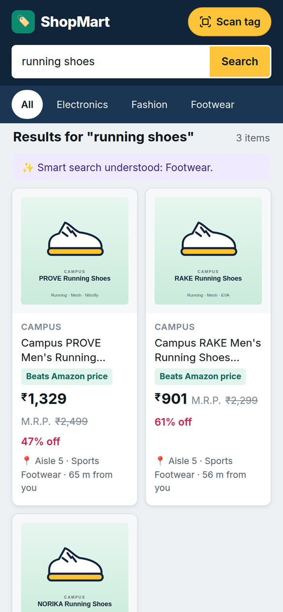
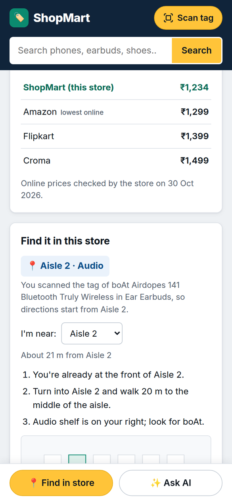
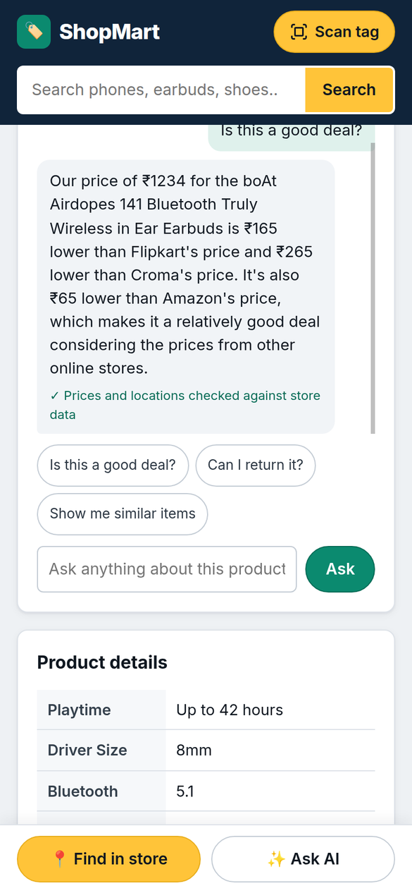
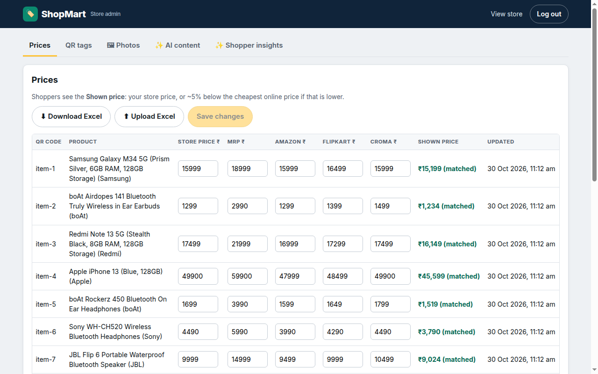
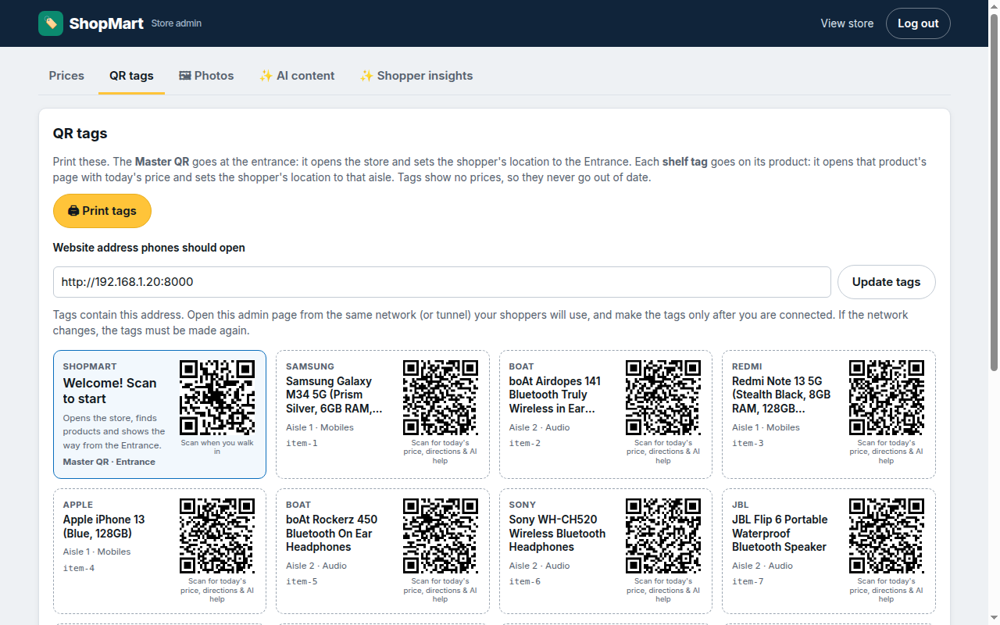
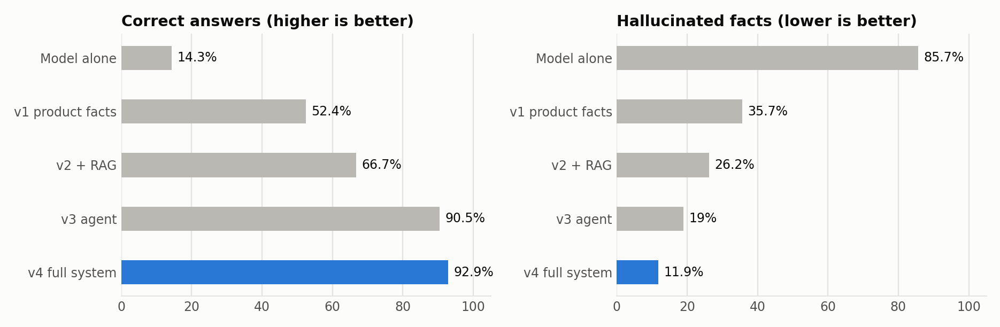

# ShopMart (OmniTag): an AI shopping assistant for a physical store

ShopMart (code name OmniTag) turns static paper price tags in a store into QR-linked product pages with online price comparison, in-store directions and a **locally hosted Generative AI shopping assistant** (Llama 3.2 through Ollama). Nothing leaves the store's own machine.

Instead of fighting "showrooming" (shoppers checking online prices in the aisle), OmniTag embraces it. Staff manage store prices and the Amazon / Flipkart / Croma prices from an admin page or an Excel sheet. A shopper scans a shelf QR code with their phone, sees the price against online prices (the store undercuts the lowest by about 5%), gets directions to the aisle, and can ask an AI assistant that looks facts up in the store's own data instead of guessing.

**Quick links:** [Demo video](https://www.linkedin.com/posts/sarup-arumugam-kumar_generativeai-rag-llm-ugcPost-7521817508392402944-viFF/) · [Set it up on your computer](docs/SETUP.md) · [Screenshots](#-screenshots) · [Results](#-results) · [How it works](docs/HOW_IT_WORKS.md) · [Try it in 10 minutes](docs/TRY_IT.md) · [Problems met while building](docs/FINDINGS.md)

**In one picture**

```
shelf QR tag ──► product page ──► question ──► guardrails ──► agent / RAG ──► fact-check ──► answer
 (no price)      today's price      (chat)      (refuse       (tools, search   (₹, aisle,     (only the
                 vs Amazon /                     attacks)      store policies)  product names   checked one
                 Flipkart / Croma                                               vs database)    is shown)
```

## 📸 Screenshots

| Search from the entrance | Today's price vs online | Checked AI answer |
|:---:|:---:|:---:|
|  |  |  |
| Every result shows how far it is from where the shopper scanned. | Store price against Amazon, Flipkart and Croma, with directions from the scanned aisle. | The answer is shown only after every price and aisle is checked against the database. |

| Store admin: prices | Store admin: QR tags (no prices on them) |
|:---:|:---:|
|  |  |

The cards in the screenshots are the generated placeholders that appear when no product photo is installed. The real demo uses official product photos, which are not included in this repository.

> **Learning the project?** Read [`docs/HOW_IT_WORKS.md`](docs/HOW_IT_WORKS.md): architecture, every GenAI technique explained with the code that implements it, how each part is tested, and the limits. Real problems met while building are logged in [`docs/FINDINGS.md`](docs/FINDINGS.md).

---

## 🌟 Key Features

### Shopping
* **Scan-to-product pages**: Each shelf tag has a QR code linking to `/p/<code>?scan=1` (the tags carry no prices, so they never go out of date; the page shows today's price). Any phone camera opens the product page directly: price vs M.R.P., online price comparison, directions to the aisle, AI advice, specs and reviews. Light, mobile-first design with a searchable catalogue and an in-page QR scanner (jsQR).
* **Master QR and "where am I?"**: One code at the entrance opens the store and sets the shopper's location to the Entrance; scanning a shelf tag sets it to that aisle. Search results show how far each product is from there, and directions (on the page and in the AI assistant) start from that spot.
* **Dynamic price matching**: Shoppers see a price ~5% below the cheapest online price entered by the admin, never above the store's own price.
* **Indoor wayfinding**: Map with an "I'm near" selector (Entrance or Aisle 1-6), route along the corridor and up the aisle, step-by-step directions with distances.

### Generative AI
* **Chat with memory**: Follow-up questions ("and the price?") work. With guardrails on, an answer is shown only after it has been fact-checked, so it never changes on screen.
* **RAG and semantic search**: Products, reviews and store policies are embedded (`nomic-embed-text`). Search understands meaning and budgets ("running shoes under 3000") and says honestly when nothing matches. Policy questions ("Can I return this?", "Is there EMI?") are answered from retrieved sections, with sources shown.
* **Tool-calling shopping agent**: Llama chooses tools (search, product lookup, comparison, store-info lookup, directions) and answers from live data. Available as "Ask the store assistant" on the home page and inside product pages when a question needs other products or policies.
* **Guardrails and fact-check**: Prompt-injection, price-haggling and off-topic requests are refused. Every ₹ amount, aisle number and product name in an answer is checked against the database; a wrong answer is regenerated once, then replaced by one built straight from the data.
* **Persona-based insights**: Structured (JSON-schema) verdict, deal score and fit for the chosen shopper type.
* **GenAI for store staff**: Review summaries and product descriptions drafted by the model (previewed, edited and approved by staff), and a "what are shoppers asking" report with suggested actions.

### Store management
* **Admin price manager** (`/admin`): Edit store price, M.R.P. and competitor prices in a table (with a live preview of the shopper price) or in bulk through Excel (all-or-nothing validation). Print shelf QR tags.
* **SQLite database** (`omnitag.db`), seeded from `seed_products.json`: 19 sample products across Electronics, Fashion and Footwear, with 3–4 products per aisle. Every product has a real, official product photo (see `docs/PHOTO_CREDITS.md`). The prices of the clothing and footwear, and all competitor prices and reviews, are illustrative sample data, not live prices. On start-up, products missing from the database are added; existing rows (and admin price edits) are never overwritten. Price edits show on the next scan.

---

## 📁 Project Structure

```
server.py            FastAPI routes: website, products, search, chat (streaming), admin
chat_service.py      One pipeline for every chat: guardrails -> answer (agent | RAG | baseline) -> fact-check -> log
agent.py             Tool-calling loop, the five tools, router (does this question need tools?)
rag.py               Embeddings index, semantic search, policy retrieval
assistant.py         Product grounding prompts, persona insight (JSON schema), chat memory
guardrails.py        Input checks, output fact-check, database-built safe answer
insights.py          Admin GenAI: review summaries, description drafts, shopper report
llm.py               The only place that talks to Ollama (chat, streaming, tools, embeddings)
store_db.py          SQLite: products, prices, embeddings, chat log; price-matching rule
wayfinding.py        Directions (Python port of web/js/wayfinding.js)
knowledge/           store_policies.md: demo store policies that RAG retrieves from
seed_products.json   Initial products
eval/                Golden set, evaluation harness, results (CSV, summary, charts)
tests/               Unit tests for the guardrails
tools/               make_product_cards.py: generated fallback product cards
docs/                SETUP.md (install and run guide), HOW_IT_WORKS.md (learning guide), FINDINGS.md (problems and fixes), TRY_IT.md (a 10-minute tour), PHOTO_CREDITS.md
web/                 Catalogue, product page, admin page (HTML, JS, CSS)
start.sh             Starts everything and sets the network address used in QR codes
```

---

## 🚀 How to Run the Project

You need [Docker](https://www.docker.com/) installed. The site runs on your laptop and is opened by phones on the same network, for example your phone's hotspot with the laptop connected to it.

> **First time on a new computer?** Follow the step-by-step guide in [`docs/SETUP.md`](docs/SETUP.md): installing Docker, NVIDIA GPU or CPU-only, Windows and macOS, running without Docker, the first-start model download, and a troubleshooting table. The short version below assumes Docker (with an NVIDIA GPU) is already working and that you are on Linux.

**Needs:** about 8 GB of free disk and 8 GB of RAM; the first start downloads about 2.5 GB of models. A GPU is optional (see the guide).

### 1. Start
```bash
./start.sh
```
This detects the laptop's network address (e.g. `http://192.168.43.10:8000`), starts Ollama (pulling **Llama 3.2** on first run) and the FastAPI server on port `8000`, and prints the addresses to use. On first run it creates `.env` with a random admin password (`ADMIN_PASSWORD`).

**Public HTTPS address (works from any network):**
```bash
./start.sh --tunnel
```
This also opens a Cloudflare tunnel and prints an `https://` address. Any phone on any network can open it, QR tags use it, and the in-page camera scanner works because the page is HTTPS. Without any setup the address is random and changes every run (`https://….trycloudflare.com`). While the tunnel runs, anyone with the link can use the site, so stop it when you are done: `docker rm -f omnitag_tunnel`. Some networks (for example a campus Wi-Fi) block the tunnel; the script then continues with the local address only.

**Fixed address on your own domain** (QR tags never go stale, and you choose the words, e.g. `shop.yourdomain.com`):
1. Create a free Cloudflare account and add a domain you own to it (a domain costs a few hundred rupees a year; Cloudflare Registrar sells them at cost).
2. In the Cloudflare dashboard open **Zero Trust → Networks → Tunnels → Create a tunnel → Cloudflared**, name it, and copy the **token**. (Cloudflare may ask for a payment method to verify the free plan.)
3. In the same tunnel, add a **public hostname**: subdomain `shop`, your domain, service type **HTTP**, URL `localhost:8000`.
4. Add two lines to `.env` (see `.env.example`): `CLOUDFLARE_TUNNEL_TOKEN=<the token>` and `PUBLIC_HOSTNAME=shop.yourdomain.com`.
5. Run `./start.sh --tunnel`. It now prints your fixed address.

The token is a secret (anyone with it can run a tunnel to your domain): keep it only in `.env`.

### 2. Use it
* **Shoppers:** open the printed address on a phone, or scan a QR tag with the phone's camera app. The tag opens that product's page directly, even if the site isn't open yet.
* **Where am I?** The **Master QR** (print it for the entrance) opens the home page and sets the shopper's location to the Entrance; scanning a shelf tag sets it to that product's aisle. Searching for another product then shows how far it is from there, its page gives step-by-step directions from that spot, and the AI assistant's directions start there too. Shoppers can also pick their spot by hand.
* **Admin:** `<address>/admin`. Edit prices, use Excel, and under **QR tags** print the shelf tags.
* **This laptop:** `http://localhost:8000`.
* **Product photos:** every product has its official product photo, stored in `uploads/` (not committed, because the pictures belong to the brands; sources are listed in `docs/PHOTO_CREDITS.md`). If a photo is missing the page falls back to a generated illustration card labelled "Illustrative image" (`python3 tools/make_product_cards.py` regenerates the cards). In **Admin → Photos** you can upload a photo (JPG, PNG or WebP) or paste an image link for any product; "reset" returns to the card.
* **Store name:** the demo storefront is branded *ShopMart* (the project itself is called OmniTag).

**If the laptop's address changes** (e.g. after reconnecting to the hotspot), run `./start.sh` again and reprint the tags, because the address is inside the QR codes.

**In-page camera scanner:** browsers only allow camera access on `https://` pages or on `localhost`. On phones opening the plain `http://` address, the **Scan tag** button explains this and offers code entry. Use the phone's camera app to scan tags instead. The in-page scanner works on the laptop.

To reset all prices to the seed data, stop the stack, delete `omnitag.db`, and start it again.

### 3. Stop
```bash
docker compose down
```

---

## 📈 Results

Measured on 42 answer questions with local `llama3.2` (3B) on a GTX 1650 (run of 29 Oct 2026, full tables and charts in `eval/results/latest-final/`). Each row adds one technique:

| Configuration | Correct answers | Answers with a wrong fact (final) |
|---|---|---|
| Model alone (no store data) | 14.3% | 85.7% |
| + product facts in the prompt | 52.4% | 35.7% |
| + RAG (store policies) | 66.7% | 26.2% |
| + tool-calling agent | 90.5% | 19.0% |
| + guardrails and fact-check (full system) | **92.9%** | **2.4%** |



The chart shows first drafts: the full system's first drafts contain a wrong fact 11.9% of the time, and after the fact-check corrects them the final rate is 2.4% (table above).

* Semantic search finds the right product in the top 3 for 95.6% of queries; keyword search 77.8%.
* Held-out attack prompts blocked: 11 of 11, with no legitimate question refused.
* "Correct" is an automatic check that every expected fact appears in the answer. It is lenient: reading the answers by hand gives about 82%. Known weak spots (competitor comparisons, price kind: MRP vs selling price) are in `docs/FINDINGS.md`.
* Test sets are small (42 answer cases, 23 attack prompts), so treat the percentages as indicative.

## 🎬 Try it

**Demo video (phone and laptop side by side):** [watch it on LinkedIn](https://www.linkedin.com/posts/sarup-arumugam-kumar_generativeai-rag-llm-ugcPost-7521817508392402944-viFF/).

`docs/TRY_IT.md` is a 10-minute tour: what to click and ask as a shopper and as the store owner, what you should see, and where the assistant is still weak.

---

## 🛠️ API Endpoints Reference

Public (`http://localhost:8000`):
* `GET /api/products`, `GET /api/products/{qr_code}`: Product records with store, shown (price-matched) and competitor prices.
* `GET /api/search?q=`: Semantic product search. Understands budgets and categories in the text.
* `POST /api/chat/stream`: Streaming chat (Server-Sent Events: `tool`, `token`, `replace`, `done`, `error`). With a `qr_code` it is a product-page chat, without one it is the store assistant. Optional `location` (`entrance` or `aisle-N`) is where the shopper scanned; directions start there.
* `POST /api/ask`: Same pipeline, one JSON answer (used by the evaluation).
* `POST /api/scan_tag`: Persona insight (JSON schema), cached per product, persona and price.
* `GET /api/health`, `GET /api/config`: Status (model, search index) and the public address used for QR codes.

Admin (need `Authorization: Bearer <token>` from `POST /api/admin/login`):
* `GET /api/admin/prices`, `PUT /api/admin/prices/{qr_code}`: List and edit prices (omitted fields stay unchanged).
* `GET /api/admin/prices.xlsx`, `POST /api/admin/prices/import`: Excel export and import.
* `POST /api/admin/ai/review-summary/{qr}`, `POST /api/admin/ai/description/{qr}`: AI drafts (previews only).
* `POST /api/admin/products/{qr}/content`: Publish an approved summary or description.
* `GET /api/admin/insights`, `POST /api/admin/insights/report`, `DELETE /api/admin/insights/log`: Shopper question statistics, AI report, clear the log.

If the LLM is unreachable the AI endpoints return `{"success": false, "error": ...}` (or an `error` event when streaming) instead of a made-up answer.

---

## 📊 Evaluation

The evaluation runs a golden set against the live system in five configurations (model alone, + product facts, + RAG, + agent, + guardrails and fact-check) so you can see what each technique adds. It also measures semantic vs keyword search, guardrail block / over-block rates on fresh phrasings, structured-output validity and (optionally) model size.

```bash
OMNITAG_TEST_HOOKS=1 docker compose up -d web-app          # enables evaluation-only switches (guardrails off, model choice)
docker exec -w /workspace local_web_app python eval/run_eval.py --quick   # ~6 minutes, smoke test
docker exec -w /workspace local_web_app python eval/run_eval.py           # full run, ~25 minutes
docker exec -w /workspace local_web_app python eval/run_eval.py --configs v4_full --models llama3.2:1b   # model size
docker compose up -d web-app                               # back to normal (switches off)
```

Results are written to `eval/results/<timestamp>/` (also `eval/results/latest/`): `results.csv` (every answer, with an empty `human_rating` column for your own 1-5 scores), `summary.md` (the tables), `summary.json` and charts (`*.png`). Questions asked during evaluation are removed from the admin shopper log afterwards. `eval/results/archive/` keeps the earlier runs that `docs/FINDINGS.md` and `docs/HOW_IT_WORKS.md` refer to; `latest-final` is the run quoted in the Results section.

Tune or check the input guardrails on any labelled prompt file (reports attacks blocked and legitimate questions wrongly blocked, rules alone vs rules + LLM guard):
```bash
docker exec -w /workspace local_web_app python eval/check_guard.py eval/guard_dev.json
docker exec -w /workspace local_web_app python eval/check_guard.py eval/golden_set.json --key safety_holdout
```

Unit tests (guardrails, fact-check, router):
```bash
docker exec -w /workspace local_web_app python -m unittest discover -s tests -v
```

---

## ⚠️ Known Limitations
* Competitor prices are entered by store staff (table or Excel), not fetched automatically. Retailers block scraping, so a manual or feed-based update is more reliable.
* Llama 3.2 (3B) is small: it can mis-handle tool calls and invent products. The fact-checker and code-computed facts reduce this but are heuristics; see `docs/FINDINGS.md` and the evaluation for measured rates.
* The fact-check compares amounts with the prices it knows, but cannot tell which kind of price a sentence means (for example the MRP quoted as if it were the selling price).
* Guardrail rules are pattern-based, so unusual paraphrases of an attack can get through (the evaluation reports the miss rate on unseen phrasings).
* Shopper questions are stored (first 300 characters, no identity) so the admin can see trends; use "Clear log" in the admin page to delete them.
* Admin login is a single shared password with in-memory sessions (8 hours); restarting the backend logs the admin out. After 5 wrong passwords, logins from that device are blocked for 5 minutes.
* The site is served over plain HTTP on the local network, so anyone on the same network can open it. Use your own hotspot rather than shared Wi-Fi when demoing.
* Indoor position comes from the shopper's chosen checkpoint, not continuous tracking (browsers have no indoor positioning).
* `docker-compose.yml` reserves an NVIDIA GPU for Ollama; remove the `deploy:` block to run on CPU (slower).

---

## License

MIT, see [`LICENSE`](LICENSE). The product photos are not part of the repository and belong to their brands (see `docs/PHOTO_CREDITS.md`). Prices, competitor prices and reviews are illustrative sample data.
